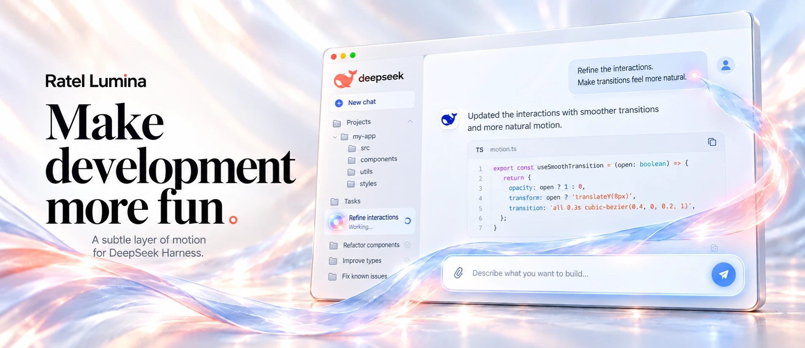

# Ratel Lumina

English · [中文](README.zh.md) · [npm](https://www.npmjs.com/package/@ratel-works/dsh-lumina) · [Changelog](CHANGELOG.md)

**Let interaction glow.**

A subtle layer of motion for DeepSeek Harness.

Ratel Lumina is a visual and motion enhancement plugin for [DeepSeek Harness](https://github.com/deepseek-ai/deepseek-harness).

Works with the DSH desktop and Web / PWA clients. Adjust the motion to your preference or switch it off at any time.

## Why Lumina

- **A consistent experience.** Coordinated visuals and motion add detail to the interface and give everyday actions clear, consistent feedback.
- **Control over the motion.** Choose an intensity, color preset and individual effects. Saved settings apply immediately.
- **Your workflow stays intact.** Lumina does not change models, requests or message content, delay submission, or block typing, clicking and selection.
- **Lightweight and optional.** Built with native browser capabilities, without an additional animation framework. A master switch turns it off, and system reduced-motion preferences are respected.

## Install and update

Install DeepSeek Harness first, then add Lumina to the profile you use:

```sh
dsh plugin --profile <profile> add @ratel-works/dsh-lumina
```

Replace `<profile>` with your profile, such as `desktop` or `web`. Run the same command to update, then **fully quit and reopen the client** to load the new plugin code.

The current development and verification baseline is DSH `0.2.1-rc.2`. Client updates can change the UI interfaces used by the effects, so compatibility needs to be checked again after an upgrade.

## Settings

Open **Lumina / 流光** in DSH settings to adjust effects, intensity and colors. Saved changes apply immediately, without restarting.

Turn off the master switch to restore the original interface. When system reduced motion is enabled, Lumina reduces or disables animations automatically.


## Documentation and development

- [Changelog](CHANGELOG.md): release changes and verification scope.
- [Motion demos](docs/demo/README.md): interaction studies and design prototypes; these are not all shipped client effects.
- [Product and implementation](docs/product/MVP.md): scope, design and engineering documentation.
- [Publishing and listing](docs/engineering/发布.md): npm releases and plugin-list submissions.

Local development checks:

```sh
npm install
npm run typecheck
npm test
npm run build
npm run install:local -- web
```

## License

The project uses the MIT license. See [THIRD_PARTY_NOTICES.md](THIRD_PARTY_NOTICES.md) for third-party sources and additional license terms.

### Brand assets

DeepSeek marks belong to their respective rights holders. This project does not claim ownership of those marks or grant brand usage rights under its MIT license. See [third-party notices](THIRD_PARTY_NOTICES.md).
