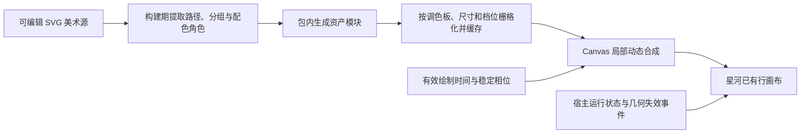

# 会话运行光团实现设计

2026-10-27。设计路线已调整为 **SVG 定义美术形态，Canvas 2D 动态合成**，用于指导当前重做。SVG 的 defs 和具名图层在构建时一起提取，运行时仅替换调色板角色并解码成共享图像。不得在 painter 中重复维护渐变参数。柔边在 SVG 解码时生成，持续绘制不调用 Canvas filter。工作区已完成 SVG 材质提取、共享解码缓存、局部动态合成和生命周期接入，仍不能视为已验收能力；1.0.0 发布行为不变。视觉与尺寸要求见[光团需求](../product/会话运行光团需求.md)。

## 1. 设计决定与边界

光团的视觉基础必须是一份静态就成立、可独立检查的 SVG 美术资产。外轮廓、内部翻卷色面、薄膜交叠和局部亮边由资产定义；运行时代码负责相对运动、轻微变形与透明合成。不能靠增加圆形渐变数量追近效果稿，也不能把整张图片旋转、缩放当作内部流动。

SVG 是本插件独立的美术源，不是在宿主 loading SVG 中追加图形。宿主节点保留状态、语义和布局；光团成功绘出后才接管其可见部分。最终画面仍绘入星河已有的行画布，复用共享调度、可见行额度和性能设置。

本轮不新增逐行 WebGPU 设备、持续 SVG 滤镜动画或第三方运行时。Canvas 合成的视觉与成本需要实测，选用它不等于保证低开销。若局部变换无法产生所需翻卷，应回到资产和运动方式修改，而不是不断增加图层。

## 2. 资产到画面的关系



当前主要文件：

| 文件 | 职责 |
| --- | --- |
| `assets/session/session-cloud.svg` | 唯一可编辑美术源，包含完整基准帧及具名分组 |
| `tools/gen-session-cloud-art.mjs` | 校验分组与路径结构，生成包内数据；不在运行时解析仓库文件 |
| `src/client/effects/session-cloud-art.generated.ts` | 构建生成的路径、视口和颜色角色数据，不手工维护 |
| `effects/session-cloud-painter.ts` 内的资源缓存 | 按调色板共享解码图层、限制容量，卸载清空；轮廓精度单独缓存 |
| `effects/session-cloud-painter.ts` | 消费资产与缓存，推进局部形变和色面相对运动，不查 DOM |
| `effects/session-galaxy.ts` | 管理宿主匹配、几何缓存、相位、接管、绘制额度及退出 |
| `effects/session.ts` | 仅在成功接管标记存在时隐藏原 ongoing 图形，保持其语义 |
| `core/performance.ts` | 集中维护质量预算，设置提示读取相同来源 |

构建工具先校验资产，失败则阻止生成；生成流程必须可重复。运行时使用包内数据，不依赖外网、效果确认稿或仓库路径。

## 3. SVG 美术资产契约

SVG 使用一个固定的归一化视口，主体、光晕和安全边界在同一坐标系内。首轮建议 `viewBox="0 0 128 128"`，最终随资产校准，但客户端不能另猜中心和裁切边界。形态采用 Bézier 路径，所有候选轮廓的路径命令与控制点数量一致，才能进行可控插值。

| 分组 | 需要画出的形态 | 动态职责 |
| --- | --- | --- |
| `silhouette` | 圆润但不规则的完整软轮廓，带少数连续鼓起 | 少量控制点在预设关键形态之间平滑插值 |
| `cool-body` | 蓝青主体及较深的内部空间 | 轻微位移、旋转和非等比变化，建立体积 |
| `warm-fold` | 珊瑚粉与紫色翻卷面，留透明交叠区 | 与主体错相移动，持续保留冷暖关系 |
| `inner-fold` | 从一侧卷入内部的半透明薄膜 | 与外轮廓不同相位，避免整体变成圆珠 |
| `rim-light` | 沿局部翻卷边界的细亮边，不能绕满一圈 | 附着所属色面，明暗局部变化 |
| `halo` | 蓝青与淡暖色分别向外消散的柔光 | 小幅呼吸，始终限制在槽位安全范围 |

基准帧必须能单独展示完整效果，分组拆开后也要能独立检查。路径、层序与透明度属于美术资产，不能在 painter 中维护第二套手写形态。颜色使用角色映射，由现有品牌色与集中定义的青、紫、亮边角色解析；不得在逐帧绘制中散落颜色字面量。

资产不得包含脚本、外链图片、字体、事件属性或 `foreignObject`。柔边滤镜只允许在资源初始化时栅格化使用，边界必须包含滤镜外扩范围；运行中不改变滤镜参数。放大确认图继续作为视觉参考，不能直接缩成贴图冒充动态。

## 4. 资源缓存与动态合成

资源准备阶段将色面、薄亮边和光晕分组栅格化为局部透明纹理。缓存键包含资产版本、已解析调色板、实际栅格尺寸和质量档位。同尺寸、同配色的会话共享资源；种子、相位与运动参数归场景所有，不因相位不同复制纹理。

动态轮廓保留少量兼容的 Bézier 关键形态。绘制时只插值控制点并生成局部遮罩；色面使用缓存纹理，在遮罩内做有限变换。轮廓软边依照实际 DPR 校准，不用硬白描边遮掩边缘。局部亮边跟随对应翻卷面，内部亮边与外轮廓亮边分别管理，不能把不贴合轮廓的纹理误当作外沿。

一次绘制顺序为：

1. 推进有效时间，计算外轮廓与各色面的不同相位。
2. 在局部工作区合成主体、暖色翻卷和内部薄膜，并用动态软遮罩约束外沿。
3. 合成所属色面的局部亮边与外围柔光，避免整团白色过曝。
4. 完成星河自身下沿遮罩后，将光团工作区贴入行画布。

星河末尾的 `destination-in` 会改变已有像素，光团必须在其后绘制；光团遮罩也只能作用于局部工作区，不能抹掉整行星河。不得通过 `getImageData` 逐像素处理，也不逐帧重建渐变、解码 SVG 或分配新画布。

时间以共享调度提供的有效间隔推进。沿用需求中的低频轮廓变化、内部交融与小幅呼吸，三者错相；不追求同频涨缩。种子由会话 key 稳定派生，不能用场景数量作为种子；列表重排、窗口恢复和重新选择不重置相位。单张整图变换不作为这三个运动层次的替代。

## 5. 宿主接入与生命周期

运行图标的真实中心是唯一锚点。绑定、图标替换、行或图标尺寸改变、缩放及相关布局失效时，统一读取图标与自有画布的 viewport 边界，换算为画布逻辑坐标：

```text
x = (iconCenterX - canvasRect.left) × logicalWidth / canvasRect.width
y = (iconCenterY - canvasRect.top)  × logicalHeight / canvasRect.height
```

几何写入场景缓存，持续绘制只读缓存。滚动时图标和行画布共同移动，不逐帧重新测量。仅位置改变但未触发尺寸变化的宿主更新也需显式使几何失效；不能仅靠 ResizeObserver 覆盖所有情况。净空不足、目标失效或资源未就绪时保留原图标，不挤占标题。

场景拥有进入、运行、退出三个视觉阶段，不增加业务状态：

- 发现有效 ongoing 后准备资源，第一帧成功且可辨认时才添加自有就绪标记；进入约 240 ms，首帧保留可识别亮度。
- 正常结束时恢复宿主图标，光团与星河共同约 420 ms 退出；错误、待确认等功能状态立即清除装饰并让位。
- 退出中再次 ongoing，从当前包络恢复；完成、失败、取消与卸载使用幂等清理。
- 可见窗口失焦不停止背景绘制；隐藏、离屏或侧栏关闭时停止无效绘制。返回时重新确认目标和几何，从保存相位续播，不补算暂停帧。上下文丢失恢复宿主标记，浏览器恢复或返回窗口后按性能架构中的有界策略重建资源。
- 减少动态、关闭开关、绘制失败或超出绘制额度时恢复宿主呈现，不能留下透明图标位。

保留原 SVG 节点、状态、可访问名称与交互属性。新增装饰使用 `aria-hidden` 和 `pointer-events: none`，沿用 `sessionActivity`，不新增专用开关或改用户配置。语义选择器继续通过适配层维护，不依赖生成类名。

## 6. 性能档位与资源上限

光团与星河共享单行画布和背景任务。继续使用最多 24 行场景、每次最多 8 个可见目标的上限；没有额度的行恢复宿主图标。纹理准备按需进行，同一缓存键只初始化一次，不能同时解码每行同一资产。关闭效果后释放缓存引用和局部工作区，待完成的异步准备结果不得在卸载后重新接管。

四档均须保留主体、暖色翻卷、内部层次和柔光。质量差异只落在分辨率、轮廓精度和附加薄膜细节，不能按色层数组截断而删除暖色。建议采用以下初值，尚未由新架构验证：

| 参数 | 性能优先 | 均衡 | 画质优先 | 极致画质 |
| --- | --- | --- | --- | --- |
| 背景 fps 上限（沿用） | 30 | 40 | 60 | 90 |
| 行画布 DPR 上限（沿用） | 1 | 1.25 | 1.5 | 2 |
| 光团额外内部薄膜数 | 0 | 1 | 1 | 2 |
| 轮廓采样精度参考 | 24 | 32 | 40 | 48 |

若最终使用原生 Bézier 路径直接绘制，不再需要轮廓采样参数，应删除该参数及设置说明，而非保留无效预算。当前试作的 `cloudLayers` 表示色层数量，与本设计的「额外薄膜数」不同，实施时需改名并同步渲染器、设置提示与测试，不能悄悄复用旧含义。

局部工作区按包含光晕的逻辑范围乘实际 DPR 分配，取整后固定，尺寸或档位变化才重建。缓存容量按当前最多 24 个场景的实际尺寸、同一活动调色板与当前档位限制，旧尺寸和旧调色板在引用归零后淘汰；不得为每一帧的形变保存纹理。具体纹理数量、字节上限与回收策略在资产定型时计算并登记到集中预算，完成前不接入客户端持续运行。

## 7. 迁移步骤与验收门槛

当前渐变叠加 painter 属于试作，保留可复用的宿主接入框架，重做资产与绘制核心。当前几何已改为事件失效测量，种子由会话 key 派生；128 像素图层与缓存容量在集中预算中维护。持续绘制不再测量 DOM 或执行模糊滤镜。

按以下顺序实施，每阶段结果满足后再继续：

1. **静态美术**：完成独立 SVG 基准帧，在 12/14/16 px 和放大视图下对照确认稿。冷暖层次、翻卷、软边和局部高光清楚；不能只有圆珠、实心点或白斑。
2. **共用动态原型**：使用最终资产与同一 painter，验证不同相位的轮廓、内部色面和亮边相对变化。预览不额外提亮、不替换高分辨率素材掩盖实际槽位表现。
3. **宿主接管**：接入几何缓存、第一帧接管、正常退出和异常让位；覆盖节点替换、重排、快速重新运行与开关卸载。
4. **资源与性能**：固定设备、视口、DPR、档位、预热和采样时长，对比插件关闭、仅星河、星河加光团的 1/3/8 行场景；分别记录主线程与 GPU，核查无逐帧布局或样式读取。

视觉还需覆盖深浅背景、品牌预设、67%–150% 比例，以及至少一个完整形变周期。隐藏、失焦、离屏、减少动态和零任务时没有持续绘制提交，恢复无跳变。资源初始化失败、超额、卸载和主题切换均不得出现双图标或空白槽位。

临时截图、动态采样和性能记录放 `.local/diagnostics/<日期-主题>/`。只有通过对应阶段才更新实现状态；构建通过、文件存在或预览放大好看均不能替代客户端验收。

## 8. 其他路线的取舍

纯 Canvas 渐变叠加难以直接维护定稿的翻卷形态，本轮试作未满足视觉目标，停止沿该方向增加图层。纯 SVG 实时滤镜与路径动画可保留作后续候选，但不能假定大量运行行同时播放没有成本。逐行 WebGPU 需要额外资源管理，当前小槽位没有足够证据支持引入。静态 PNG 或完整 SVG 的整体旋转缺少内部相对运动，不作为目标实现。

若 SVG 资产配合局部 Canvas 合成仍不能满足真实尺寸的形变和翻卷，应先提交差距与固定场景证据，再调整渲染路线，不直接扩大纹理、滤镜或图层预算。

## 9. 当前重做的资源约束

每个调色板共用 10 个 128×128 图层，缓存最多 4 套，解码像素预算约 2.5 MiB（不含浏览器内部副本）。图层异步解码期间保留宿主图标；首次完整绘制后接管。缓存使用最近访问顺序淘汰，卸载时清空。内部暖面与亮边使用同一局部变换，避免亮边悬浮。外轮廓只在小幅度内变化，柔边由缓存素材提供。当前仍待视觉和客户端验收。

## 10. 材质原型重评（2026-10-27）

用户否决 SVG 色面合成版的观感。新增独立 `docs/demo/session-cloud-volume.html` 原型，以连续三维噪声扭曲密度场和薄膜等值面，沿视线累积透明色光，验证内部翻涌与柔软边缘是否更接近确认稿。该原型使用单个 WebGL2 画布；小尺寸样本复用同一绘制结果，不逐行分配 GPU 上下文。此阶段不修改客户端渲染路线，不把原型观感或性能写为已验收。若视觉成立，再设计共享小尺寸纹理图集与现有调度器的接入方案。

2026-10-27 小尺寸可读性调整：保留用户认可的体积材质，将可见变化集中于 2–3 个大轮廓鼓起、冷暖色块交界和主薄膜亮部的移动。首轮目标是在 12 px 主体上连续观察约 1–2 秒即可辨认变化；形变采用连续低频场，避免通过整体旋转、闪烁或增加细密纹理表达运行。先以原型审阅，时长与幅度尚未验收。

原型后续调整：外边界采用近圆形密度包络，独立于内部强流场，轮廓谐波幅度收至约 6%，保持圆润并保留轻微鼓起。红蓝占比使用独立约 4 秒周期连续交替，内部薄膜速度不随颜色一起倍增；不做瞬时切色。

## 11. 体积材质客户端接入（2026-10-27）

用户认可收圆及快速红蓝交替的原型，授权先接入客户端。当前路线调整为一个按需创建的共享 WebGL2 离屏上下文，沿用原型相同的密度场、色彩交替与薄膜着色器；逐行将小尺寸结果贴入既有星河 Canvas。所有绘制由现有共享背景调度驱动，最多 8 行可见场景，不创建逐行 GPU 上下文或独立循环。

四档改为光团纹理边长 32/40/48/64、体积采样步数 24/32/40/48，设置提示共用集中预算。时钟及约 4 秒红蓝周期各档一致。最大共享渲染目标 64×64，设置切换及卸载释放程序和上下文；上下文丢失或初始化失败恢复宿主图标，不回退到已否决的 SVG 软球。预览与客户端引用同一 shader，预览放大视图使用较高分辨率，小尺寸样本须另用客户端绘制器验证。品牌颜色通过 uniform 传入，不逐帧读取样式和几何。

本节取代第 1–9 节的 SVG 动态合成路线；早期 SVG 仅保留为试作资产。GPU 总成本和客户端实际观感待验证，不以低主线程时间宣称性能收益。

### 首帧接管修订

运行状态 DOM 变更在 MutationObserver 的微任务检查点处理，新场景在该检查点完成几何测量和首次绘制，成功后立即隐藏宿主圆环，随后才交给背景调度续帧。不得把扫描和首次绘制拆为连续两个 rAF；不对宿主 opacity 添加淡出，以免与光团重叠。首帧绘制失败或目标不可见时保留宿主图标；不通过提前无条件隐藏所有运行图标消除闪烁。
