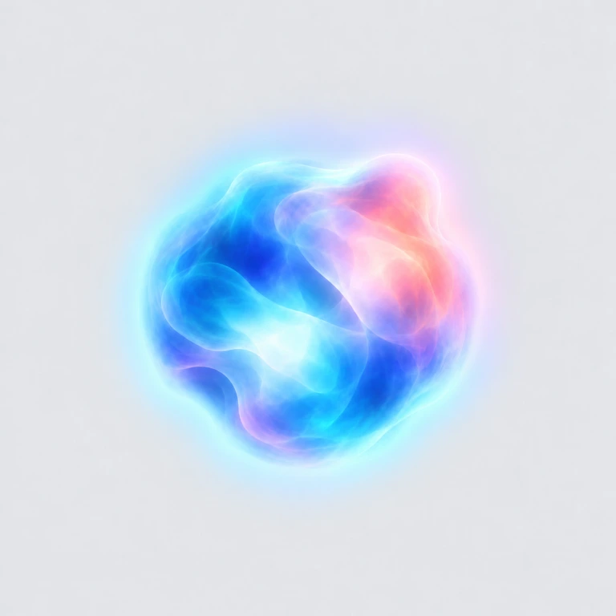

# 会话运行光团需求

2026-10-27：用户已确认光团与外围柔光的视觉稿。本需求用于替换左侧会话行的旋转 loading；工作区已有未验收试作，已按用户认可的圆润体积原型接入共享 GPU 小画布，预览与客户端共用绘制器，真实客户端观感尚待验收；1.0.0 仍使用原有圆环与星河。

## 确认的视觉

原始确认稿保存在 [PNG](../../assets/reference/session-running-cloud.png)，上图为便于阅读的 WebP。图为放大后的独立效果稿，灰色是展示背景，不能作为客户端贴图底色。实现设计见[会话运行光团实现设计](../engineering/会话运行光团实现设计.md)：采用独立 SVG 美术源定义轮廓、翻卷和局部亮边，Canvas 复用缓存素材实现相对运动。先确认静态造型，再验证动态与客户端接管。

运行标记采用有体积的柔软光团：蓝、青为主要色块，少量珊瑚粉和紫色在内部交融；不同位置有柔和亮部，保留透明层次。轮廓大致圆润但不规则，边缘自然散开。外围增加随轮廓分布的淡彩光晕，蓝青与淡粉分别承接内部色块，向外平滑消失。

形变参考语音助手光团的柔和流动感。最终形象以本确认稿为准，不复刻 Siri 的具体图形或界面。此前的小光点、扁透镜和带连接线方案均不再采用。

## 放入会话行后的表现

光团放在原有运行图标的槽位，保持标题、时间、缩进和行高。主体建议从 12 × 12 CSS px 起调，变形的最大外沿约 14 px，连同柔光的绘制范围控制在约 20 × 20 px；最终必须服从真实槽位与相邻文字的净空。空间不足时等比收小，不推挤文字。

小尺寸保留三个识别点：柔软变形的轮廓、内部冷暖光色交融、克制的外围柔光。放大稿的细密纹理不要求逐像素缩入图标。禁止把确认稿直接缩成静态图片冒充动态实现。

底部星河沿用当前方向、位置和流动方式。左侧光团负责快速识别运行状态，星河提供持续流动的氛围；两者使用协调的色源和明暗节奏。光团与星河之间留自然空间，不增加连接线、光柱或拖尾。

## 动态节奏

以下为首轮实现初值，静态定稿没有确认这些时长；以真实尺寸动态对比收敛。

| 动态 | 首轮初值 | 需要保持的观感 |
| --- | --- | --- |
| 轮廓形变 | 约 4–7 s 的低频变化叠加，半径偏移约 6%–12% | 局部鼓起、回落连续，不整团机械旋转，不逐帧随机抖动 |
| 内部色光 | 约 3–6 s 的缓慢交融 | 冷暖色块有相对运动，不能只改变整团透明度 |
| 呼吸 | 约 3.6 s，亮度与体积小幅变化 | 最暗时仍能识别运行，缩放幅度约 ±3%，没有强闪或白色过曝 |
| 出现与正常结束 | 约 240 ms 淡入，约 420 ms 淡出 | 与星河一起进入和收尾，不影响会话状态更新 |

形变、内部流动和呼吸存在相位差，避免三者一起规律涨缩。不同运行会话使用稳定的细小相位差；列表重排、窗口恢复和快速切换不重播起点。

## 状态与设置

| 情况 | 要求 |
| --- | --- |
| 正在运行 | 成功绘制光团后才隐藏原圆环的可见部分；保留宿主节点、状态和辅助技术语义 |
| 选中或未选中的运行会话 | 使用同一种光团；选中仍由原有底板表达 |
| 正常结束 | 光团与星河淡出，回到宿主空闲呈现；不推断未读状态或增加完成提示 |
| 错误、待确认、暂停等功能状态 | 立即让位给宿主图标和文字，不用光团猜测或代替这些状态 |
| 再次运行 | 从当前可见状态平滑恢复，不闪回完全透明再重播 |
| 系统减少动态、效果关闭或接入失败 | 使用宿主状态标记，不留空白图标位，不播放光团与星河的持续运动 |
| 窗口失焦、隐藏、离屏、侧栏收起 | 停止无效绘制；恢复时不补算积压帧 |

沿用现有 `sessionActivity` 开关，设置页名称与说明需覆盖“光团与星河”；不新增光团专用开关、颜色选择器或拟造的进度百分比。绘制质量跟随四档综合性能偏好，动效强度只调整表达幅度，不改状态含义。

## 验收重点

- 先看真实槽位尺寸，再看放大细节。能辨认柔软光团、内部色光和外围光晕，不能退化为旋转圆环、扁透镜、实心点或一团白斑。
- 连续观察至少一个完整形变周期，轮廓和内部色块都在变化，起止不跳变。
- 同时展示 1、3、8 行运行状态，标题、时间和操作按钮清晰，光晕不压住相邻文字。
- 正常结束、再次运行及异常状态切换均无双图标、空白槽位或遮挡宿主提示。
- 覆盖深浅色、不同品牌预设、67%–150% 界面比例、滚动与面板折叠、失焦恢复、减少动态以及关闭总开关。
- 预览和客户端使用同一绘制器与尺寸映射；实现前的动态原型达到上述观感后，再接入真实会话生命周期。

2026-10-27 动态验收方向已更新：用户认可圆润体积材质原型，要求先接客户端。外轮廓保持近圆、轻微柔软起伏；红蓝占比约每 2 秒交替主次，连续过渡。预览和客户端共用着色器，小尺寸预览使用客户端绘制器。此前 SVG 软球方案已否决，不作为接入失败的视觉回退。
